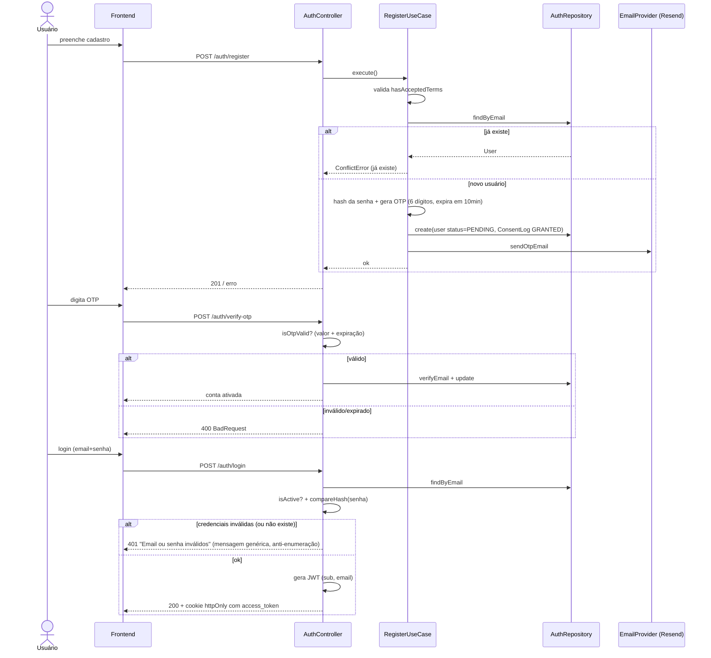
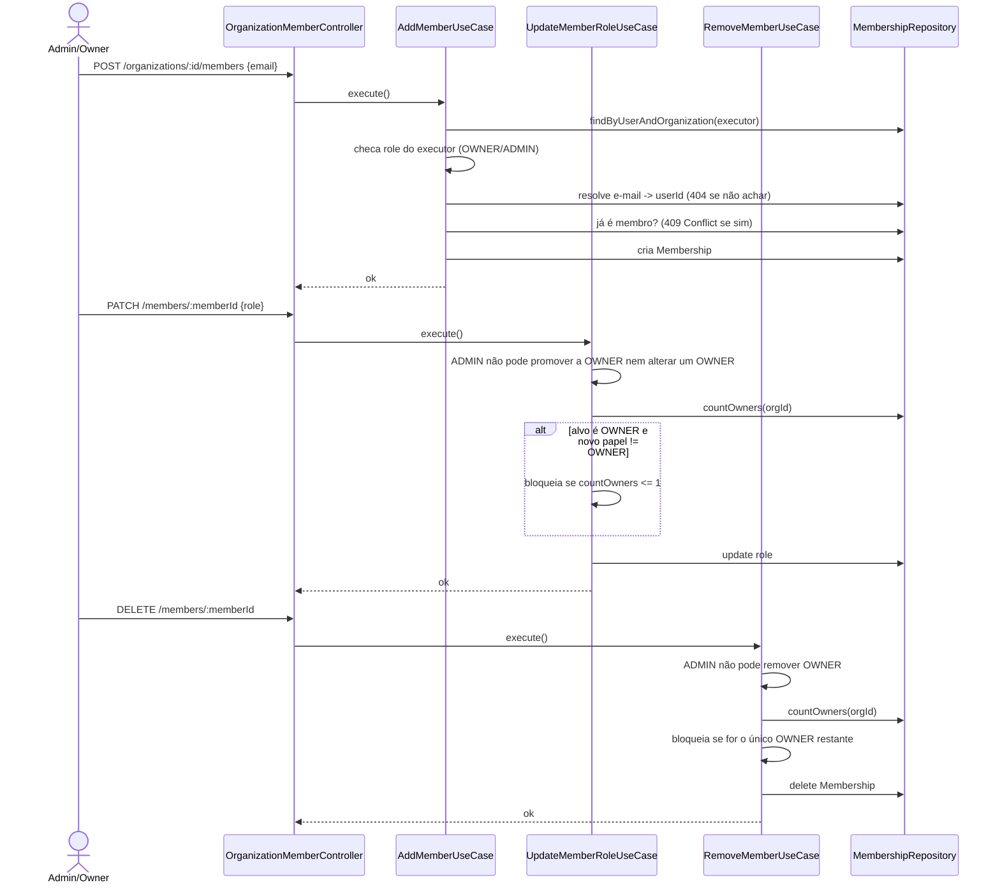
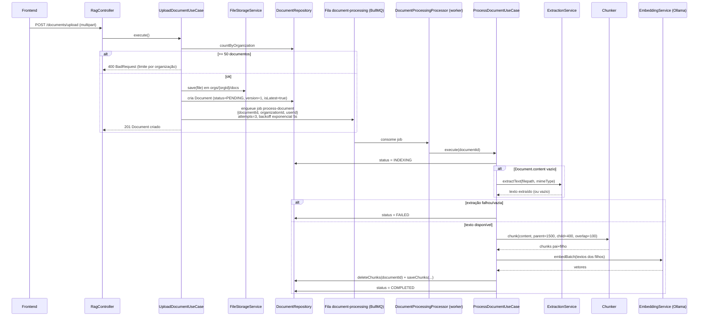
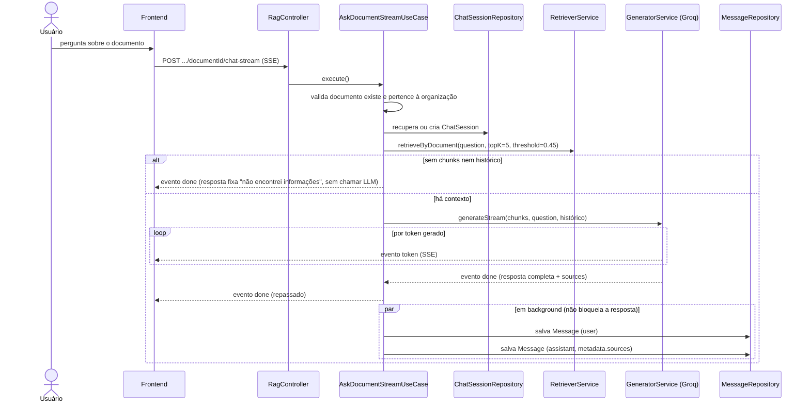
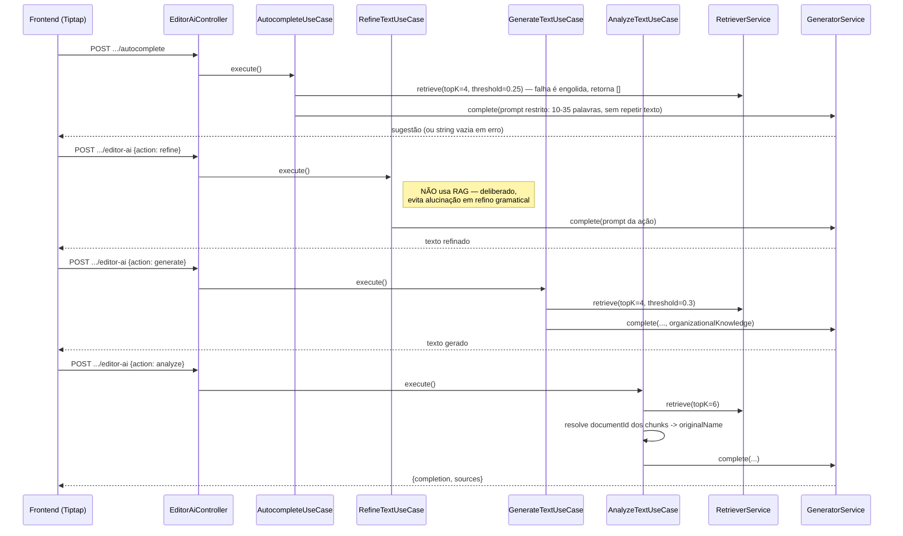
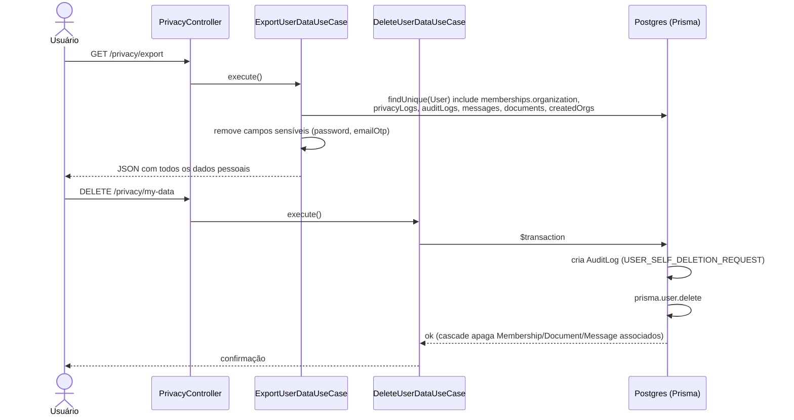
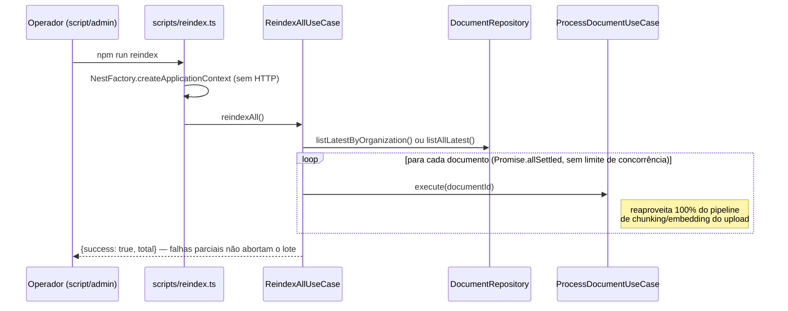

# Fluxos de execução

Fluxos reais do backend `consult.ia`, extraídos dos use cases (não apenas dos controllers). Nomes entre parênteses são o arquivo/classe que implementa cada passo.

## 1. Registro, verificação por OTP e login

**Reenvio de OTP**: exige que a conta ainda esteja `PENDING` (senão `BadRequestError` "já verificada"); gera novo OTP/expiração e reenvia por e-mail.

**Esqueci/resetar senha**: `forgot-password` sempre responde com a mesma mensagem genérica, exista ou não o e-mail (anti-enumeração); se existir, gera um token UUID válido por 2h e envia por e-mail (falha de envio aqui é só logada, nunca propagada ao usuário). `reset-password` valida o token (`isResetTokenValid`) antes de trocar a senha.

## 2. Convite/gestão de membro de organização

Todos os use cases de membro exigem que quem executa a ação tenha `Membership` com papel `OWNER` ou `ADMIN` na organização (senão `UnauthorizedError`).

**Regra central:** uma organização nunca pode ficar sem nenhum `OWNER` — tanto `UpdateMemberRole` quanto `RemoveMember` checam `countOwners(organizationId) <= 1` antes de permitir a operação.

## 3. Upload → extração → chunking → embedding → indexação

Se o job falhar com exceção, o BullMQ reaplica o retry (até 3 tentativas); o use case nunca relança erro no final — qualquer falha é capturada e vira `status: FAILED` no próprio documento. **Reindexação manual** (`POST .../reindex`) apenas marca `status: PENDING` e reenfileira o mesmo job, reaproveitando 100% deste pipeline.

## 4. Pergunta ao RAG via streaming (SSE)

**Chat em nível de organização** (`ask-organization-stream`) é o mesmo fluxo, mas com `ChatSession.documentId = null`, buscando em todos os documentos da organização (`RetrieverService.retrieve`, com filtro opcional por um documento específico) e montando um `docListContext` extra (lista de nomes de documentos) para o prompt. Qualquer exceção durante o streaming vira um evento `error` no SSE — a conexão nunca cai sem avisar o cliente.

## 5. Editor AI

Cada ação decide, de forma diferente, se e como usa o RAG organizacional:

`analyze` é o único dos quatro que expõe `sources` (nome do documento de origem) explicitamente na resposta.

## 6. Exportar / excluir dados pessoais (LGPD)

Fora do escopo direto da rota, mas no mesmo módulo: `purgeOldSessions` (remove `ChatSession` antigas) e `clearExpiredOtps` (limpa OTP expirado de contas não verificadas) — usados por uma rotina de limpeza periódica (`purge-old-logs.use-case.ts`).

## 7. Reindexação em lote

:::caution Ponto de atenção observado durante a pesquisa
`reindexAll` dispara todos os documentos em paralelo via `Promise.allSettled` **sem limite de concorrência** — em uma base grande, isso pode sobrecarregar o Ollama (embeddings) e estourar rate limit do Groq (se algum passo usar LLM). Vale considerar um limite de concorrência (ex.: `p-limit`) se a base de documentos crescer.
:::
