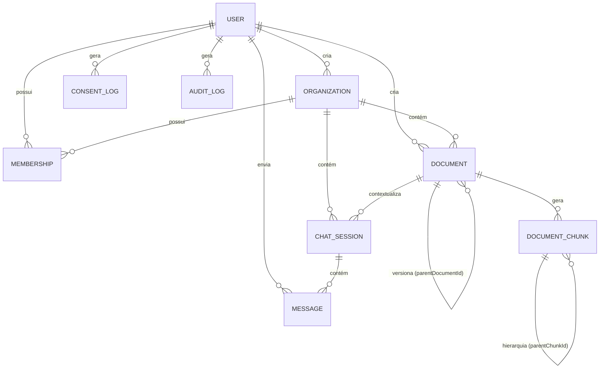

# Modelo de dados

Fonte: `consult.ia/prisma/schema.prisma` (datasource `postgresql`, gerador `prisma-client-js`).

## Enums

### `OrganizationRole`
Papel (RBAC) de um usuário dentro de uma organização, usado em `Membership.role`.
- `OWNER`
- `ADMIN`
- `MEMBER`

### `DocumentSource`
Origem de um `Document`.
- `UPLOAD` — enviado via upload de arquivo.
- `INTERNAL` — criado internamente (sem upload), default `UPLOAD`.

### `MessageFeedback`
Feedback do usuário sobre uma resposta do RAG, em `Message.feedback`.
- `THUMBS_UP`
- `THUMBS_DOWN`

## `User` (tabela `users`)

Conta de usuário da plataforma.

| Campo | Tipo | Obrigatório | Default | Relação |
|---|---|---|---|---|
| `id` | String (uuid) | sim | `uuid()` | — |
| `name` | String | sim | — | — |
| `email` | String | sim (único) | — | — |
| `password` | String | sim | — | — |
| `avatarUrl` | String | não | — | — |
| `emailVerified` | Boolean | sim | `false` | — |
| `emailOtp` | String | não | — | — |
| `emailOtpExpiresAt` | DateTime | não | — | — |
| `status` | String | sim | `"PENDING"` | — |
| `passwordResetToken` | String | não (único) | — | — |
| `passwordResetExpiresAt` | DateTime | não | — | — |
| `memberships` | Membership[] | — | — | 1:N → `Membership` |
| `createdOrgs` | Organization[] | — | — | 1:N → `Organization` (relação nomeada `OrganizationCreator`) |
| `documents` | Document[] | — | — | 1:N → `Document` |
| `messages` | Message[] | — | — | 1:N → `Message` |
| `createdAt` | DateTime | sim | `now()` | — |
| `updatedAt` | DateTime | sim | auto (`@updatedAt`) | — |
| `consentedAt` | DateTime | não | — | — |
| `consentVersion` | String | não | — | — |
| `aiTokenQuota` | Int | sim | `1000000` | limite de tokens de IA do usuário |
| `aiTokenUsed` | Int | sim | `0` | consumo acumulado |
| `privacyLogs` | ConsentLog[] | — | — | 1:N → `ConsentLog` |
| `auditLogs` | AuditLog[] | — | — | 1:N → `AuditLog` |

Sem `@@index` explícito além do `@unique` em `email` e `passwordResetToken`.

## `Organization` (tabela `organizations`)

Tenant do sistema — tudo (documentos, chats) é escopado por organização.

| Campo | Tipo | Obrigatório | Default | Relação |
|---|---|---|---|---|
| `id` | String (uuid) | sim | `uuid()` | — |
| `name` | String | sim | — | — |
| `description` | String | não | — | — |
| `slug` | String | sim (único) | — | — |
| `createdBy` | String | sim | — | FK → `User.id` |
| `creator` | User | — | — | N:1 → `User` (relação `OrganizationCreator`) |
| `memberships` | Membership[] | — | — | 1:N → `Membership` |
| `documents` | Document[] | — | — | 1:N → `Document` |
| `chatSessions` | ChatSession[] | — | — | 1:N → `ChatSession` |
| `createdAt` | DateTime | sim | `now()` | — |
| `updatedAt` | DateTime | sim | auto | — |
| `aiTokenQuota` | Int | sim | `1000000` | limite de tokens de IA da organização |
| `aiTokenUsed` | Int | sim | `0` | consumo acumulado |
| `retentionDays` | Int | não | `90` | política de retenção de versões de documento, em dias |

## `Membership` (tabela `memberships`)

Vínculo N:N materializado entre `User` e `Organization`, carregando o papel (RBAC).

| Campo | Tipo | Obrigatório | Default | Relação |
|---|---|---|---|---|
| `id` | String (uuid) | sim | `uuid()` | — |
| `userId` | String | sim | — | FK → `User.id`, `onDelete: Cascade` |
| `organizationId` | String | sim | — | FK → `Organization.id`, `onDelete: Cascade` |
| `role` | OrganizationRole | sim | — | enum |
| `user` | User | — | — | N:1 |
| `organization` | Organization | — | — | N:1 |
| `createdAt` | DateTime | sim | `now()` | — |

**Constraint:** `@@unique([userId, organizationId])` — um usuário só pode ter um vínculo por organização.
**Cascade:** excluir o `User` ou a `Organization` apaga o `Membership` em cascata.

## `Document` (tabela `documents`)

Documento enviado/criado em uma organização — entrada do pipeline de RAG.

| Campo | Tipo | Obrigatório | Default | Relação |
|---|---|---|---|---|
| `id` | String (uuid) | sim | `uuid()` | — |
| `filename` | String | sim | — | — |
| `originalName` | String | sim | — | — |
| `filepath` | String | não | — | — |
| `filesize` | Int | sim | — | — |
| `mimeType` | String | sim | — | — |
| `content` | String (`@db.Text`) | não | — | texto extraído |
| `status` | String | sim | `"UPLOADED"` | valores usados em código: `UPLOADED`, `EXTRACTING`, `INDEXING`, `COMPLETED`, `FAILED` |
| `source` | DocumentSource | sim | `UPLOAD` | enum |
| `indexed` | Boolean | sim | `false` | — |
| `organizationId` | String | sim | — | FK → `Organization.id`, `onDelete: Cascade` |
| `createdBy` | String | sim | — | FK → `User.id` |
| `organization` | Organization | — | — | N:1 |
| `creator` | User | — | — | N:1 |
| `chunks` | DocumentChunk[] | — | — | 1:N → `DocumentChunk` |
| `chats` | ChatSession[] | — | — | 1:N → `ChatSession` |
| `uploadedAt` | DateTime | sim | `now()` | — |
| `updatedAt` | DateTime | sim | auto | — |
| `deletedAt` | DateTime | não | — | soft delete / expiração de retenção |
| `version` | Int | sim | `1` | — |
| `isLatest` | Boolean | sim | `true` | — |
| `parentDocumentId` | String | não | — | FK → `Document.id` (auto-relação) |
| `parentDocument` | Document | — | — | N:1, relação nomeada `DocumentVersions` |
| `childVersions` | Document[] | — | — | 1:N, relação nomeada `DocumentVersions` |

**Índices:** `@@index([indexed])`, `@@index([uploadedAt])`, `@@index([organizationId])`.
**Versionamento:** cada versão é uma linha própria, ligada à anterior via `parentDocumentId`; `isLatest` marca a versão corrente.

## `DocumentChunk` (tabela `document_chunks`)

Pedaço de um `Document` pós-chunking — unidade de busca vetorial do RAG.

| Campo | Tipo | Obrigatório | Default | Relação |
|---|---|---|---|---|
| `id` | String (uuid) | sim | `uuid()` | — |
| `documentId` | String | sim | — | FK → `Document.id`, `onDelete: Cascade` |
| `content` | String (`@db.Text`) | sim | — | — |
| `chunkIndex` | Int | sim | — | posição do chunk no documento |
| `embedding` | `Unsupported("vector(768)")` | não | — | **campo vetorial** (ver nota abaixo) |
| `metadata` | Json | não | — | — |
| `parentChunkId` | String | não | — | FK → `DocumentChunk.id` (auto-relação), `onDelete: Cascade` |
| `parentChunk` | DocumentChunk | — | — | N:1, relação `ChunkToParent` |
| `childChunks` | DocumentChunk[] | — | — | 1:N, relação `ChunkToParent` |
| `createdAt` | DateTime | sim | `now()` | — |
| `document` | Document | — | — | N:1 |

**Índices:** `@@index([documentId])`, `@@index([parentChunkId])`.

:::info Campo vetorial (pgvector)
`embedding` é declarado como `Unsupported("vector(768)")` — ou seja, usa a extensão **pgvector** do PostgreSQL com vetores de **768 dimensões**, mas o tipo não é suportado nativamente pelo Prisma Client (precisa de SQL raw para ler/escrever/consultar esse campo, tipicamente via `$queryRaw`/`$executeRaw` com operadores de distância do pgvector, ex. `<=>`). Isso confirma que a busca por similaridade do RAG é feita no Postgres via pgvector, não em um banco vetorial externo. Detalhes em [Modelo de IA e pipeline RAG](./modelo-ia.md).
:::

Há também uma estrutura hierárquica de chunks (`parentChunkId` / `childChunks`), sugerindo chunking em múltiplos níveis (ex.: chunk "pai" maior contendo chunks "filhos" menores).

## `ChatSession` (tabela `chat_sessions`)

Conversa de um usuário — pode ser sobre um documento específico ou um chat global da organização.

| Campo | Tipo | Obrigatório | Default | Relação |
|---|---|---|---|---|
| `id` | String (uuid) | sim | `uuid()` | — |
| `documentId` | String | não | — | FK → `Document.id`, `onDelete: Cascade` (opcional = chat global) |
| `organizationId` | String | não | — | FK → `Organization.id`, `onDelete: Cascade` |
| `userId` | String | sim | — | dono da sessão (sem FK declarada no schema) |
| `title` | String | não | — | gerado automaticamente a partir da primeira pergunta |
| `document` | Document | — | — | N:1 |
| `organization` | Organization | — | — | N:1 |
| `messages` | Message[] | — | — | 1:N → `Message` |
| `createdAt` | DateTime | sim | `now()` | — |
| `updatedAt` | DateTime | sim | auto | — |

**Índices:** `@@index([documentId])`, `@@index([organizationId])`, `@@index([userId])`.

## `Message` (tabela `messages`)

Mensagem (pergunta ou resposta) dentro de uma `ChatSession`.

| Campo | Tipo | Obrigatório | Default | Relação |
|---|---|---|---|---|
| `id` | String (uuid) | sim | `uuid()` | — |
| `sessionId` | String | sim | — | FK → `ChatSession.id`, `onDelete: Cascade` |
| `userId` | String | sim | — | FK → `User.id` |
| `role` | String | sim | — | ex.: `"user"` / `"assistant"` (valor livre, sem enum) |
| `content` | String (`@db.Text`) | sim | — | — |
| `metadata` | Json | não | — | — |
| `feedback` | MessageFeedback | não | — | enum |
| `createdAt` | DateTime | sim | `now()` | — |
| `session` | ChatSession | — | — | N:1 |
| `user` | User | — | — | N:1 |

**Índices:** `@@index([sessionId])`, `@@index([createdAt])`.

## `ConsentLog` (tabela `consent_logs`)

Registro de consentimento do usuário (LGPD).

| Campo | Tipo | Obrigatório | Default | Relação |
|---|---|---|---|---|
| `id` | String (uuid) | sim | `uuid()` | — |
| `userId` | String | sim | — | FK → `User.id`, `onDelete: Cascade` |
| `action` | String | sim | — | valores em código: `"GRANTED"`, `"REVOKED"` |
| `consentType` | String | sim | — | valores em código: `"PRIVACY_POLICY"`, `"DATA_PROCESSING"` |
| `policyVersion` | String | sim | — | — |
| `ipAddress` | String | não | — | — |
| `userAgent` | String | não | — | — |
| `createdAt` | DateTime | sim | `now()` | — |
| `user` | User | — | — | N:1 |

## `AuditLog` (tabela `audit_logs`)

Trilha de auditoria de ações administrativas/sensíveis.

| Campo | Tipo | Obrigatório | Default | Relação |
|---|---|---|---|---|
| `id` | String (uuid) | sim | `uuid()` | — |
| `userId` | String | não | — | FK → `User.id` (nulo = ação do sistema) |
| `action` | String | sim | — | valores em código: `"READ_USER"`, `"UPDATE_USER"`, `"EXPORT_USER"`, etc. |
| `targetId` | String | não | — | id do recurso afetado |
| `targetType` | String | não | — | valores em código: `"USER"`, `"DOCUMENT"`, etc. |
| `metadata` | Json | não | — | — |
| `ipAddress` | String | não | — | — |
| `createdAt` | DateTime | sim | `now()` | — |
| `user` | User | — | — | N:1 (opcional) |

## `AiUsageLog` (tabela `ai_usage_logs`)

Registro de consumo de IA, para métricas/custo (consumido pelo painel admin).

| Campo | Tipo | Obrigatório | Default | Relação |
|---|---|---|---|---|
| `id` | String (uuid) | sim | `uuid()` | — |
| `model` | String | sim | — | nome do modelo usado (ver [Modelo de IA](./modelo-ia.md) para os modelos reais em uso) |
| `type` | String | sim | — | ex.: `"EMBEDDING"`, `"GENERATION"` |
| `provider` | String | sim | — | ex.: `"GROQ"`, `"OLLAMA"` |
| `inputTokens` | Int | sim | `0` | — |
| `outputTokens` | Int | sim | `0` | — |
| `totalTokens` | Int | sim | — | sem default |
| `cost` | Float | sim | `0` | custo estimado em USD |
| `organizationId` | String | não | — | sem FK declarada no schema |
| `userId` | String | não | — | sem FK declarada no schema |
| `documentId` | String | não | — | sem FK declarada no schema |
| `createdAt` | DateTime | sim | `now()` | — |

Nenhum índice declarado.

## Resumo das relações

- `User` 1:N `Membership`
- `User` 1:N `Organization` (como criador, relação `OrganizationCreator`)
- `User` 1:N `Document` (como criador)
- `User` 1:N `Message`
- `User` 1:N `ConsentLog`
- `User` 1:N `AuditLog` (opcional)
- `Organization` 1:N `Membership`
- `Organization` 1:N `Document`
- `Organization` 1:N `ChatSession`
- `Document` 1:N `DocumentChunk`
- `Document` 1:N `ChatSession` (opcional)
- `Document` 1:N `Document` (versionamento, auto-relação `DocumentVersions`)
- `DocumentChunk` 1:N `DocumentChunk` (hierarquia pai/filho, auto-relação `ChunkToParent`)
- `ChatSession` 1:N `Message`
- `User` ↔ `Organization` via `Membership` (N:N materializado, com `role`)

:::note Modelos sem FK declarada no Prisma
`ChatSession.userId` e `AiUsageLog.organizationId`/`userId`/`documentId` são strings simples, sem `@relation` no schema — a integridade referencial para esses campos é garantida apenas na aplicação, não pelo banco.
:::
