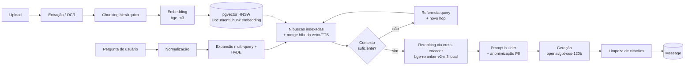

# Modelo de IA e pipeline RAG

Esta página documenta, com base direta no código (`consult.ia/src/modules/rag` e `modules/editor-ai`), quais modelos são usados em cada etapa do pipeline, com quais parâmetros, e como as etapas se encadeiam. Onde o código não deixa algo explícito, isso é sinalizado.

## 1. Extração / OCR

`CompositeExtractionAdapter` escolhe a estratégia por mimetype do arquivo:

| Tipo de arquivo | Estratégia |
|---|---|
| `text/*` | Leitura direta do buffer. |
| `.docx` | `mammoth.extractRawText`. |
| `application/pdf`, modo `FAST` (**default atual**) | `pdf-parse` extrai texto direto; se vier vazio, cai em OCR. |
| `application/pdf`, modo `DEEP_VISION` (desativado por padrão) | `VisualExtractionAdapter`, página a página, limite de 30 páginas (`MAX_VISION_PAGES`). |
| Outro mimetype | `400 BadRequestException`. |

No modo `FAST`, o OCR de fallback é: **AWS Textract** se o PDF tiver mais de 30 páginas, senão **OCR local**.

A extração visual (quando ativa) e qualquer análise de imagem usam `VisionAdapter.analyzeImage`, que chama o Groq com o modelo **`meta-llama/llama-4-scout-17b-16e-instruct`** (multimodal), `temperature: 0.1`. O prompt pede reconstrução semântica completa da página (texto + descrição de gráficos/tabelas/assinaturas) em Markdown. O uso é logado em `AiUsageLog` com `type: 'VISUAL_EXTRACTION'`.

## 2. Chunking hierárquico (parent/child)

`Chunker` divide o texto extraído em parágrafos (regex `\n\s*\n`) e, quando um parágrafo é muito longo, em sentenças. Gera uma estrutura **parent → child**, refletida no schema (`DocumentChunk.parentChunkId`):

| Parâmetro | Valor (`RAG_CONFIG.CHUNKING`) |
|---|---|
| Tamanho máximo do chunk-pai | 1500 caracteres (contexto enviado ao LLM) |
| Tamanho máximo do chunk-filho | 400 caracteres (unidade de embedding) |
| Overlap entre chunks-filho vizinhos | 100 caracteres |

:::note
O método `Chunker.chunk()` tem defaults internos diferentes (2000/400/50), mas eles são sobrescritos pelos valores de `RAG_CONFIG` no pipeline real de indexação.
:::

## 3. Embedding

`OllamaEmbeddingAdapter` usa o modelo **`bge-m3`** (multilíngue, 1024 dimensões), via `POST {OLLAMA_BASE_URL}/api/embed` (default `http://localhost:11434`). Custo sempre `0` (modelo local, roda on-prem). Logado em `AiUsageLog` com `provider: 'OLLAMA'`, `type: 'EMBEDDING'`.

A dimensão do vetor é fixada pela coluna `vector(1024)` no Postgres (ver [Modelo de dados](./modelo-de-dados.md)), com índice HNSW (`m=16, ef_construction=64`) sobre `vector_cosine_ops`.

:::note Histórico
O projeto já usou `nomic-embed-text` (768 dim) e, antes disso, a API da OpenAI (`text-embedding-3-small`, 1536 dim) — migrada para um modelo local por motivos de custo e de compliance (LGPD/governança documental, tema central deste projeto): processar conteúdo de documentos de clientes através de uma API externa de embeddings era uma decisão de privacidade, não só de qualidade. `bge-m3` foi escolhido por ser multilíngue e rodar localmente via Ollama, mantendo essa garantia.
:::

Trocar o modelo de embedding exige **reindexar toda a base** (`pnpm reindex` — ver [Fluxos › Reindexação em lote](./fluxos.md)), já que vetores de modelos diferentes não são comparáveis entre si.

## 4. Retrieval — busca híbrida indexada em pgvector

A busca vetorial roda **dentro do Postgres via pgvector** (índice HNSW), não em um vector DB externo.

É uma busca **híbrida**: o score final combina o score vetorial com full-text search em português do Postgres (`to_tsvector('portuguese', ...)`, `plainto_tsquery`):

| Parâmetro | Valor (`RAG_CONFIG.HYBRID_SEARCH`) |
|---|---|
| Peso do score vetorial | 0.8 |
| Peso do score full-text | 0.2 |

A query faz `LEFT JOIN` do chunk-filho com o chunk-pai (`parentChunkId`) e retorna o conteúdo do **pai** quando existir (`COALESCE(p.content, c.content)`) — busca-se no granular, mas devolve-se o contexto mais amplo para o LLM.

### Pré-processamento da pergunta antes de buscar

1. **Normalização** (`normalizeQuery`) — remove termos de cortesia via regex ("por favor", "gostaria de saber", etc.).
2. **Multi-Query Expansion + HyDE numa única chamada** (`RerankerAdapter.expandAndHypothesize`) — um só prompt Groq gera, no mesmo JSON, as 3 variações semânticas da pergunta **e** a resposta hipotética (HyDE), que também é embedada e usada como mais uma query de busca. Consolidado em uma chamada (antes eram duas sequenciais) para reduzir latência e pressão no rate limit do Groq.

### Por que N buscas indexadas em vez de uma só

Cada variação de query (original + 3 expansões + HyDE) é embedada e vira **uma busca própria**, no padrão `ORDER BY embedding <=> $vetor LIMIT k` — o único formato que o índice HNSW do pgvector consegue acelerar. Os resultados das N buscas são mesclados em memória (`RetrieverAdapter.mergeVectorRows`), mantendo o maior score por chunk entre todas as variações.

:::info Decisão de arquitetura (2026-10-13)
Antes, as N distâncias eram combinadas numa única expressão SQL via `GREATEST(...)` dentro de um `GROUP BY` — um padrão que o Postgres **não consegue** acelerar com o índice HNSW, mesmo ele existindo (foi confirmado com `EXPLAIN`: a query antiga sempre caía em *sequential scan*, recalculando a distância contra todo chunk da organização, para cada variação, em toda pergunta). A reescrita faz N buscas indexadas em paralelo e mescla os candidatos em JS, preservando o ganho de recall do multi-query sem abrir mão do índice. Em bases pequenas o Postgres ainda pode preferir *seq scan* por ser mais barato (confirmado via `EXPLAIN`), mas a partir de um volume maior de chunks o índice passa a ser usado automaticamente — o teto de escala que existia antes foi removido.
:::

### Parâmetros de retrieval (`RAG_CONFIG.RETRIEVAL`)

| Parâmetro | Valor | Observação |
|---|---|---|
| `DEFAULT_TOP_K` | 8 | chunks retornados por padrão |
| `THRESHOLD` | 0.45 | score mínimo de similaridade |
| `MAX_CANDIDATES` | 12 | candidatos por hop antes do rerank — reduzido deliberadamente para evitar rate limit (TPM 6000) do Groq no reranker |
| `MAX_CONTEXT_CHARS` | 12000 | orçamento de caracteres do contexto final (`applyContextBudget`) |
| `MAX_HOPS` | 2 | retrieval iterativo: 1 hop inicial + no máx. 1 hop extra (ver seção 4.1) |

O score é recalibrado por uma função **sigmoide** (`calibrateScore`, k=14, x0=0.42) só para exibição/ordenação ficar mais "humana" (menos cru que cosseno puro).

:::info Calibração empírica (2026-10-13)
`THRESHOLD` e os parâmetros da sigmoide foram recalibrados com base em medição real após a troca para `bge-m3` (os valores antigos eram herdados do `nomic-embed-text` e nunca haviam sido revalidados). Usando `src/scripts/calibration-probe.ts` — 5 perguntas on-topic contra os documentos reais indexados e 4 perguntas off-topic (capital da Mongólia, receita de bolo, relatividade geral, futebol) — medi o score combinado bruto (vetor×0.8 + FTS×0.2) de cada uma:

- Piso do sinal (menor score entre as on-topic): `0.4822`
- Teto do ruído (maior score entre as off-topic): `0.3562`
- Gap real: `0.126`

Com `k=14, x0=0.42, THRESHOLD=0.5`, todas as 5 perguntas relevantes calibram entre `0.70` e `0.94` (passam), e todas as 4 irrelevantes calibram entre `0.03` e `0.29` (são filtradas) — boa margem dos dois lados. Rode `pnpm calibration-probe` de novo sempre que trocar o modelo de embedding.

**Atualização (mesmo dia)**: o achado acima (FTS sempre contribuindo 0) foi corrigido — ver `buildCoOccurrenceTsQuery` abaixo.
:::

### Full-text search: de AND-de-tudo para co-ocorrência de pares

O `plainto_tsquery('portuguese', pergunta)` original exige que **todas** as palavras da pergunta apareçam no mesmo chunk (semântica AND) — em chunks de ~400 caracteres isso quase nunca acontece, e por isso o FTS sempre contribuía `0` (confirmado empiricamente nas 9 perguntas de teste acima). A correção óbvia — trocar AND por OR (qualquer palavra basta) — foi testada e **descartada**: produzia falsos positivos graves por palavras comuns/polissêmicas (ex.: a pergunta "qual a capital da Mongólia?" batia com score `1.0` num trecho sobre "capital de risco", mesma palavra, sentido totalmente diferente).

A solução implementada em `RetrieverAdapter.buildCoOccurrenceTsQuery`: extrai os lexemas já stemizados do `plainto_tsquery` (reaproveitando o dicionário de português do Postgres), descarta termos com conteúdo ≤ 2 caracteres (ex.: "é", "ia" — ruído demais pra discriminar sozinhos), e monta uma tsquery exigindo **pelo menos 2 desses termos juntos no mesmo chunk** (`(termo1 & termo2) | (termo1 & termo3) | ...`). Isso elimina o falso positivo de palavra única/comum, mantendo recall real quando dois ou mais termos de conteúdo coincidem.

Resultado medido (mesmo conjunto de 9 perguntas): FTS passou a contribuir sinal real em 4 das 5 perguntas on-topic (0.03–0.49 de `ts_rank_cd`), com ruído OFF-topic praticamente intacto (só um resíduo de ~0.008, sem efeito prático). O gap sinal/ruído do score combinado aumentou de 0.126 para 0.133 — ganho líquido, sem necessidade de recalibrar `k`/`x0`/`THRESHOLD` de novo.

### Fallbacks quando a busca não encontra nada

1. Se nada passa no `THRESHOLD`, a busca é refeita com o threshold reduzido pela metade.
2. Se mesmo assim nada é retornado (só em `retrieveByDocument`), o sistema devolve os dois primeiros chunks estruturais do documento (`parentChunkId: null`, ordenados por `chunkIndex`), com um score simbólico de 0.1 — garante que o LLM sempre receba *algum* contexto em vez de nada.

## 4.1. Retrieval iterativo (multi-hop)

Depois do primeiro hop (threshold + fallback), o `RetrieverAdapter` chama `RerankerAdapter.assessAndReformulate` (`gpt-oss-20b`, 1 chamada): avalia se o contexto recuperado já é suficiente para responder a pergunta original e, se não for, já devolve no mesmo JSON a query reformulada focada no que falta — sem precisar de uma segunda chamada separada. Isso cobre perguntas com mais de uma parte (ex.: "compare X com Y") onde o primeiro hop costuma trazer só um lado.

A query reformulada é embedada e vira mais **um hop de busca indexada** (mesclado nos resultados já existentes, não substituindo-os). O processo é limitado por `RAG_CONFIG.RETRIEVAL.MAX_HOPS` (hoje `2`, ou seja: no máximo 1 hop extra) para não estourar latência/custo — cada hop extra adiciona 1 chamada Groq (avaliação + reformulação consolidadas) além da nova busca indexada. Em caso de erro na avaliação, o sistema falha de forma permissiva (`sufficient: true`) e não força hop adicional.

Testado em produção local: uma pergunta simples resolve em 1 hop (~5s); uma pergunta comparativa de duas partes dispara o segundo hop (~49s, a maior parte do tempo em chamadas Groq sequenciais).

## 5. Reranking (cross-encoder dedicado, local)

Até 2026-10-13 o reranking era feito por LLM-as-judge via Groq (`gpt-oss-20b` pontuando cada trecho). Foi substituído por um **cross-encoder dedicado**: `bge-reranker-v2-m3` (GGUF, `gpustack/bge-reranker-v2-m3-GGUF:Q4_K_M`), servido localmente via `llama.cpp` (`llama-server --embedding --pooling rank --reranking`), rodando como serviço próprio no `docker-compose.yml` (`reranker`, porta `8081`), chamado pelo backend via `CrossEncoderRerankerAdapter` (`POST /v1/rerank`, compatível com Jina).

Motivação da troca: pesquisei antes — **Ollama não tem endpoint de rerank** (pedido em aberto desde 2024, nunca implementado); `llama.cpp` tem, e de forma documentada pra esse modelo específico. Isso mantém o reranker **100% local** (mesma lógica de privacidade/LGPD que já motivou sair da OpenAI pros embeddings via Ollama), remove 1 chamada Groq por pergunta, e dá scores mais consistentes/decisivos que o LLM-as-judge (testado: pergunta relevante → logit bruto `~2.0`; irrelevante → `~-11.0`, separação bem mais nítida que a do juiz por LLM).

O cross-encoder devolve um **logit bruto sem limite definido** (não é 0-1) — `CrossEncoderRerankerAdapter.normalizeScore` aplica uma sigmoide (`1/(1+e^-x)`) antes de virar `confidenceScore`, pra manter compatibilidade com o resto do sistema (inclusive a UI do frontend, que exibe a confiança como percentual). Limitado a 8 candidatos, truncados em 1200 caracteres cada (mesmo limite de antes). Em caso de erro/serviço fora do ar, cai de volta para a ordem original com `confidenceScore: 0` (mesma resiliência de antes).

A expansão de query e a resposta hipotética (HyDE) continuam no Groq, agora numa classe separada (`QueryAugmentationAdapter`, antes chamada `RerankerAdapter` — renomeada porque não faz mais reranking), ambas com **`openai/gpt-oss-20b`** (`temperature: 0.2` para a chamada consolidada de expansão+HyDE, `temperature: 0` para avaliação de suficiência + reformulação do retrieval iterativo).

## 6. Geração da resposta final

`GeneratorAdapter` usa o Groq com modelo **`openai/gpt-oss-120b`** (maior que o usado no reranker/expansão).

| Caso de uso | `temperature` |
|---|---|
| Pergunta RAG (`generate` / `generateStream`) | 0.2 |
| Completar texto no editor (`complete`, usado pelo `editor-ai`) | 0.7 |

Timeout de 60s, até 3 retries. Antes de enviar ao Groq, a pergunta e o prompt passam por `Anonymizer.redactPII` (redação de dados pessoais). Suporta streaming (`generateStream`, usado no chat-stream/SSE); como o Groq não expõe `usage` por chunk em streaming, os tokens são estimados por `length / 4` após o fim do stream.

Toda chamada de geração passa por `CheckQuotaUseCase` **antes** (bloqueia se a cota de IA da organização/usuário estourou) e por `IncrementQuotaUseCase` + registro em `AiUsageLog` (custo calculado via `calculateAiCost`, em `common/utils/ai-pricing.ts`) **depois**.

### Prompt de sistema (`PromptBuilder.build`)

Fixo e explícito no código. Define:
- O papel do assistente ("consultor sênior de IA").
- Regra de fidelidade estrita ao contexto recuperado — "Zero-Out-of-Context": nunca usar conhecimento geral do modelo fora do que veio do retrieval.
- Formato de citação obrigatório por trecho: `[ID: ...] | [FONTE: nome]`.
- Mensagem de fallback educada para quando não há informação suficiente no contexto.
- Instrução para não repetir o mesmo `[ID: ...]` em sequência dentro do mesmo parágrafo.

## 7. Limpeza de citações

`CitationCleaner.clean()` é pós-processamento puramente textual (regex, sem chamada de IA): remove citações `[ID: ...]` duplicadas consecutivas dentro do mesmo parágrafo, mantendo apenas a última ocorrência de cada ID antes de uma mudança de fonte.

## 8. Editor AI — reaproveitando o RAG

`EditorPromptService.buildPromptForAction()` mapeia uma ação (`continue`, `develop`, `simplify`, `grammar`, `review_source`, `review_full`, `summarize`, `formal`, `custom`) para um prompt fixo em português. `develop` tem regras explícitas (expansão acadêmica/técnica longa, sem subtítulos, sem conclusões); `custom` usa o prompt livre do usuário e falha se vazio; ação desconhecida lança erro.

Os use-cases do editor (`autocomplete`, `generate-text`, `refine-text`, `analyze-text`) seguem todos o mesmo padrão:

1. Montam uma `searchQuery` combinando o fim do texto já escrito no editor + o prompt/ação.
2. Chamam `retriever.retrieve(organizationId, searchQuery, topK=4, threshold=0.25|0.3)` — um RAG "leve" (sem rerank/HyDE explícitos no use case, mas o próprio `retrieve` já herda expansão multi-query/HyDE internamente).
3. Passam o resultado como `organizationalKnowledge` para `generator.complete()`.

`autocomplete` usa um prompt de sistema à parte, bem mais restritivo: 10–35 palavras, proibido repetir o texto já escrito, proibido introduções.

## O que não está explícito no código

- **Uso do modo `DEEP_VISION` em produção**: depende de uma env/flag que sobrescreva `RAG_CONFIG.EXTRACTION.DEFAULT_MODE`; nenhum override foi encontrado nos arquivos lidos — o default no código é `'FAST'`.
